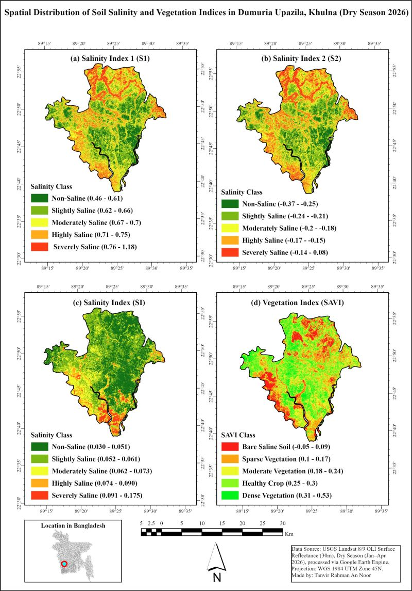

# Spatial Assessment of Soil Salinity and Vegetation Dynamics in Dumuria Upazila, Khulna

* **Tools Used:** Google Earth Engine (JavaScript API), ArcGIS Pro
* **Dataset:** USGS Landsat 8/9 Level-2 Surface Reflectance
* **Indices Calculated:** Salinity Indices (S1, S2, SI) and Soil-Adjusted Vegetation Index (SAVI)

### Map Output

